# Polaris
 
**Every coder needs a North Star.**
 
Polaris is a live star-sky for a coding club. Members post a "signal" (a star) when they need a teammate, a coding-challenge partner, or a study buddy. When someone answers, a line connects the two stars. An AI keeper, built as a Creao agent running on Claude, cleans every post, removes personal details, suggests teammates, finds verified opportunities, and handles unsafe messages with a crisis card.
 
Built solo at Cal Hacks 13.0 (Oct 23-25, 2026).
 
- Demo video: ``
- Live app: 
- Figma: `https://www.figma.com/make/wEEJSx70svXkftYjENgcqj/Polaris-Coding-Club-Star-Sky?t=fammuchhtHsVtOV2-20&fullscreen=1`
---
 
## The problem
 
I founded one of my school's coding cluba. The hardest part is not the code, it's the first message: "Does anyone want to work with me?" Members stay quiet because:
 
- They do not want to post a phone number, school detail, or personal message in a group chat.
- They do not know who in the club has the skills or goals that match theirs.
- Opportunities (internships, hackathons, fellowships) get lost in chat scroll, or turn out to be expired or fake.
- Group chats can also receive messages from someone who is struggling, and a club chat is not a safe place for that to go unnoticed.
  

## What Polaris does
 
| Feature | How it works |
| --- | --- |
| **Star sky** | Every open signal is a gold star on a shared live sky. Members appear as small dots. Verified opportunities are teal diamonds. |
| **Send a signal** | A member writes a post like they would text a friend. The keeper rewrites it, removes personal details (phone numbers, handles, addresses), labels it (teammate, challenge, study, other), and only then is it posted. The raw message is never stored. |
| **Answer a signal** | One click connects you to the star. The line appears on every member's screen instantly. Answering is atomic: two people cannot answer the same star at once. |
| **Teammate suggestions** | The keeper reads the post and the members' skills and goals, and suggests up to three people. Members decide whether to reach out. |
| **Find opportunities** | The keeper searches, checks links and deadlines, and returns suggestions. A member approves each one before it goes on the sky. |
| **Safety gate** | If a message suggests the writer may be in danger, nothing is posted. The member sees a calm message with 911 and 988. |
| **Report** | Any member can report a star. It is hidden right away. |
 
## System design
 

 
## How the AI keeper works
 
The keeper is a Creao agent, and it does the core work of the app, not decoration. Every post and every opportunity search goes through it.
 
- **Agent ID:** `d81264f3-e09b-40fa-aca7-595ed57396c7`
- **Run share link:** `https://agent.creao.ai/share/d69153f80aa6aec9e9df9dd457bf87e0`
- **Model:** Claude Sonnet 5.5, running inside Creao
- **Modes:**
  - `match`: clean the post, remove personal details, pick a category, suggest teammates, or return a crisis result.
  - `find_opportunities`: search for opportunities that fit a member's interests, verify links and deadlines, and return a list.
- **Output:** a single JSON result with an `action` field (`post` or `crisis`), the cleaned text, the category, whether personal details were removed, and matches or items.
### Why a small local server sits between the app and the agent
 
The Creao API key must never reach the browser. `server/keeper.mjs` is a small Node server that:
 
1. Holds the Creao key (loaded from `.env.server`, which is gitignored).
2. Starts an agent run, polls for the result, and retries with a wait if Creao rate-limits.
3. Finds the real result block in the agent's text (the agent can print several JSON blocks).
4. Validates and trims every input, limits body size, and limits simultaneous runs.
5. Allows only the app's own origin (`localhost:5173` / `localhost:5174`).
6. Caches opportunity searches for 30 minutes so repeat searches are instant.
## Why SpacetimeDB
 
The whole experience depends on a shared, live state:
 
- **Subscriptions** make every star, line, and diamond show up on every member's screen immediately, with no polling code.
- **Reducers** hold the rules on the server side: only members can post, a signal is 1-200 characters, you cannot answer your own signal, and two people cannot answer the same star at once.
- **One module, one source of truth.** The client never writes to tables directly.
Tables: `member`, `signal`, `connection`, `opportunity`, `report`.
Reducers: `joinClub`, `postSignal`, `connectSignal`, `postOpportunity`, `reportSignal`.
 
## Safety and privacy by design
 
- **Crisis gate.** A message that suggests danger is never posted. The member gets a calm message with 911 and 988.
- **Personal details are stripped before storage.** The database only ever sees the cleaned text.
- **Humans approve opportunities.** The keeper suggests. A member decides what goes on the sky.
- **Report button.** Hides a star immediately.
- **Prototype label.** The app says it is not an emergency service.
- **Club code is a soft gate.** This repository is public, so the club code in the module can be read by anyone. It keeps casual visitors out of the demo, but it is not real access control. A production version would use SpacetimeAuth or another OIDC provider.
- **No secrets in the repo.** `.env.server` and `.env.local` are gitignored. `.env.server.example` shows the format.
## Measuring impact
 
Polaris is built for one real club, and I would measure it with a small number of honest signals:
 
- **Time to first answer:** how long a signal waits before someone answers it.
- **Share of signals answered:** how many stars become connections.
- **New members who post:** members who send their first signal in their first week.
- **Opportunities approved and clicked.**
- **Safety events:** how often the crisis gate fires, and whether any reports were needed.
 
## Tech stack
 
- **SpacetimeDB 2.x** (TypeScript module, Maincloud database `polaris-calhacks`)
- **React + Vite + TypeScript** client with generated bindings
- **Creao** agent running **Claude Sonnet 5.5**
- **Node** keeper server
  
## Run it yourself
 
You need Node 20+, the SpacetimeDB CLI, and a Creao account with an agent.
 
```bash
git clone `https://github.com/hannay-sen/polaris.git`
cd polaris
npm install
```
 
1. **Create the keeper's secrets file.** Copy `.env.server.example` to `.env.server` in the project root and fill in your own values:
```
   CREAO_API_KEY=your_creao_api_key
   CREAO_AGENT_ID=your_agent_id
```
   Never commit this file.
2. **Publish the database module.** Pick your own database name, change `CLUB_CODE` in `spacetimedb/src/index.ts`, then:
```bash
   spacetime publish your-database-name
```
3. **Generate the client bindings** (needed after any schema change):
```bash
   spacetime generate --lang typescript --out-dir src/module_bindings --project-path spacetimedb
```
4. **Start the keeper server** in its own terminal:
```bash
   node --env-file=.env.server server/keeper.mjs
```
5. **Start the app** in another terminal:
```bash
   npm run dev
```
   Open `http://localhost:5173`, join with your club code, and send a signal.
 
To try two members at once, open a second window in a private or incognito browser. Each browser gets its own identity.
 
## Project layout
 
```
spacetimedb/src/index.ts   SpacetimeDB module: tables and reducers
src/App.tsx                The star-sky app
src/module_bindings/       Generated SpacetimeDB client types
server/keeper.mjs          Local server between the app and the Creao agent
.env.server.example        Format of the secrets file (the real one is gitignored)
```
 
## Design (Figma)
 
`https://www.figma.com/make/wEEJSx70svXkftYjENgcqj/Polaris-Coding-Club-Star-Sky?t=fammuchhtHsVtOV2-20&fullscreen=1`
 
## Known limits
 
- The keeper takes about 30 seconds to run a post. The app says so while it works.
- The keeper server runs on the presenter's laptop for the demo. A real deployment would host it.
- Opportunity results depend on what the agent can verify at that moment, and a human approves each one.
- The club code is a soft gate (see above).
- Polaris is a prototype and **not an emergency service**. If you are in danger, call 911. In the US you can call or text 988.
  
## What next
 
- **Go public as a website.** The database already runs on SpacetimeDB Maincloud. The app would be built and hosted on a static host (Vercel, Netlify, or Cloudflare Pages), and the keeper server would move to a small hosted service (Render, Railway, or Fly.io) with the Creao key stored as a secret.
- **Limits before going public.** Only joined members could use the keeper, with a per-member and daily cap, so strangers cannot run up the agent.
- **Real sign-in** through SpacetimeAuth with club-level roles, replacing the soft club code.
- **Mobile.** The interface is already responsive, so the first step is an installable web app (add to home screen) with a manifest and the Polaris icon. A native app, for example with Capacitor, would come only if clubs adopt it.
- **Admin view.** Let a club admin see reports and review hidden stars.
- **Per-club skies,** so any club can run its own Polaris.
  
## Credits
 
Built by Thel (`hannay-sen`) for Cal Hacks 13.0. Agent built on Creao and Claude Sonnet 5.5. Realtime backend by SpacetimeDB.
